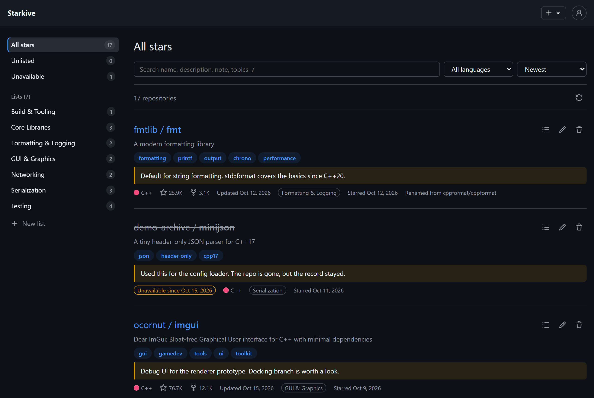
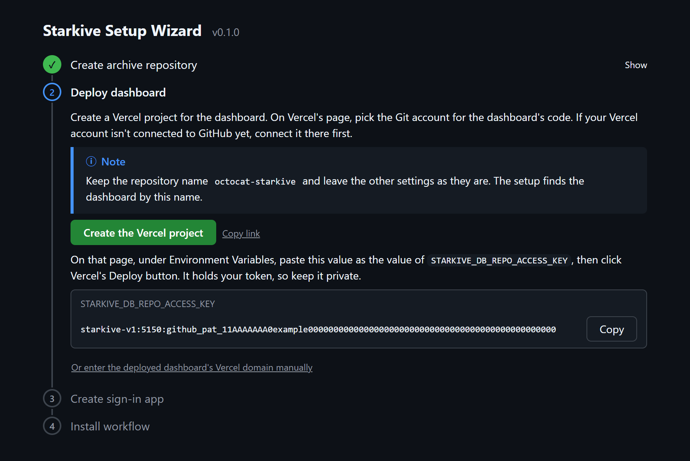

# starkive

A private archive for the GitHub repositories you want to remember. Save repositories without starring them, sort them into lists, write notes, and keep them even after they disappear from GitHub.



## Why

GitHub stars are a public bookmark list:

- Your stars and star lists are visible to everyone.
- There is nowhere to write notes about a repository.
- Unstar a repository, or have it deleted or made private, and it is gone from your list without a trace.

Keeping a private list in a notes app instead means copying links by hand, writing descriptions yourself, and finding out too late that a link is dead. starkive does that bookkeeping for you, in a repository you own.

starkive is developed with a focus on keeping a private, lasting record of the repositories you care about, rather than on extras like AI tagging or smart search.

## What you get

- **Save without starring.** Add any repository from the dashboard, or from any GitHub repository page with the **Add to starkive** bookmarklet. Nothing shows up on your public profile.
- **Entries outlive the repository.** starkive keeps each repository's description, language, topics and license. When a repository is deleted or made private, its entry stays readable and is marked as unavailable, so you still know what it was. Renames are followed, and unstarring on GitHub doesn't remove anything.
- **Yours, in your own repository.** The archive is plain JSON in a repository on your GitHub account (private by default), and every change is a commit, so you have the full history and can take it anywhere. Lists and notes are yours alone, and only your GitHub account can sign in.
- **No server to run, no bill.** It runs on Vercel's free plan and GitHub, with no database to host or maintain.
- **One place on every device.** A web dashboard you can open from your laptop or phone, with search, lists and notes.
- **Bring your stars along.** Import the stars you already have, with their GitHub star lists, and let starkive pick up new stars automatically (every day by default).
- **Read-only toward your stars.** starkive never stars or unstars anything. Its token can write only to your archive repository, and otherwise just reads your stars.

## Quickstart

### Prerequisites

- A GitHub account
- A [Vercel](https://vercel.com) account connected to your GitHub account (the free plan is enough)

### Steps

1. **Download and run the setup tool:**
   - Windows: Download and run `starkive-setup_windows_amd64.exe` from the [latest release](../../releases/latest).
   - Linux: Run the following command in a terminal:

     ```
     curl -LO https://github.com/xorespesp/starkive/releases/latest/download/starkive-setup_linux_amd64 && chmod +x starkive-setup_linux_amd64 && ./starkive-setup_linux_amd64
     ```

   - macOS: Run the following command in a terminal:

     ```
     curl -LO https://github.com/xorespesp/starkive/releases/latest/download/starkive-setup_darwin_arm64 && chmod +x starkive-setup_darwin_arm64 && ./starkive-setup_darwin_arm64
     ```

> [!NOTE]
> The setup tool isn't code-signed, so your browser or system may warn you about it. Keep the file and run it anyway. To check the download, compare its SHA-256 with the one on the release page.

2. **Follow the setup page.** The setup tool opens it in your browser and walks you through the steps that need you:

   

   - **Create archive repository.** Enter a name for your archive (your GitHub username works well), then click **Create the repository**. The name and **Private** are filled in: keep the name and create it empty, with no README, `.gitignore` or license. Then click **Create the token**. That page is filled in for your archive repository: under **Repository access**, choose **Only select repositories**, pick that repository, generate the token, and paste it back.
   - **Deploy dashboard.** Click **Create the Vercel project** and pick your Git account (Vercel puts a copy of the dashboard's code there). Keep the repository name, paste the value the setup page shows under **Environment Variables**, and click **Deploy**. The setup page notices when the deployment is ready and continues on its own. If Vercel gives the dashboard a different address, enter it there (the production domain under the Vercel project's **Domains**).
   - **Create sign-in app.** Click **Create the GitHub App**, then **Create GitHub App** on GitHub's page. This app is how you sign in, and it gets no access to your repositories.

> [!NOTE]
> To run the setup in the terminal instead of the browser, add `-headless`.

3. **Open the dashboard and sign in with GitHub.** Your archive picks up new stars automatically (every day by default). Change how often, turn it off, or sync right away in **Settings**, in the account menu.

If you ever replace the token, run the setup tool again, put the new value in Vercel, and redeploy. The tool tells you if anything else needs to change.

## Running from source

To build and run the setup tool from source, run it from a clone. You need [Git](https://git-scm.com/) and [Go](https://go.dev/dl/) 1.22 or later:

```
git clone https://github.com/xorespesp/starkive
cd starkive
go run ./tools/setup
```

> [!NOTE]
> The setup tool deploys the commit you run it from, so that commit must be pushed to a public GitHub repository.

## Updating

To update the dashboard to the latest release, clone the GitHub repository that Vercel deploys your dashboard from, and run the update script in it. You need [Git](https://git-scm.com/). On Windows, run the commands in Git Bash.

```
git clone https://github.com/<your-username>/<vercel-deployed-repository>
cd <vercel-deployed-repository>
sh update.sh
```
